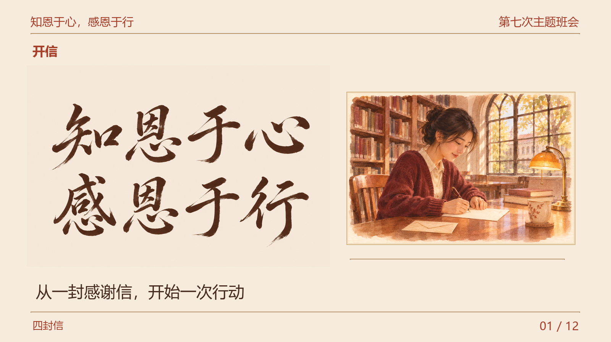

# 短视频学习：从案例效果到可执行方法

保留的学习来源为此前记录的抖音视频/图文：瑶瑶创赛PPT《无人机巡检》、皮诺曹PPT《寒域氢源》《星影随箭》、PPT学姐爱偷懒的整页生图示例、佳豪PPT的机械臂美化。这里整理已有学习材料，没有重新访问或核验视频。原手机目录是历史位置，不是当前素材入口。

使用方法时先判断题材、素材与目标软件。不要将历史教学案例的科技蓝金、赛事标签或高密度装饰强加给班会。

## 方法怎样落地

| 方法 | 适合什么时候 | 页面里怎样实现 | 怎样判断有效 |
| --- | --- | --- | --- |
| 从文案提炼主题色 | 新风格、没有指定参考 | 从实际场景选择底色/文字色/强调色，再做代表页 | 图文对比清楚，配色与题材有关；不按关键词机械套色 |
| 标题成为主视觉 | 简短主题或关键观点 | 比较字形、行数、字距与主图位置，少量使用艺术字 | 标题正确可读，缩略看主次清楚，放大无纸底方块 |
| 主体融入背景 | 水彩、纸张、无边场景 | 去掉不需要的相框，处理纸底与边缘，保留主体细节 | 实际底色上没有突兀矩形；不把柔边称为完整抠图 |
| 层次与视觉路径 | 产品、故事或过程 | 用尺度、前后关系、留白或路径组织内容 | 去掉装饰后关系仍能理解；不凑图层与元素数量 |
| 目录与导航 | 内容较长，需要定位 | 用章节标记帮助找到当前位置 | 导航提供方向而不挤压正文；短班会不强制六章节 |
| 整页AI视觉草图 | 缺少构图灵感 | 生成后参考构图，用原生正文重建可编辑页面 | 不把整页栅格图冒充可编辑PPT，文字与数据重新核对 |
| 按讲解揭示 | 问答、流程、对照 | 记录问题/提示/结论的顺序，写入实际对象，再放映 | 讨论前不泄露提示；点击数符合节奏，不只统一转场 |

字体与融合方法不限于封面。动画表中的做法是对讲解流程的应用，不声称这些视频已验证了当前工具的动画能力；实现边界见[动画连续性规范](动画连续性规范.md)。

## 实际案例：原图不换，只改变呈现

以下两图来自本项目生成素材的页面，均为**Pillow近似预览，不是WPS截图**。只用于比较图像边缘、标题底色与页面背景的关系，不作为整套作品或目标软件已验收的证明。

处理前：标题字图有矩形纸底，插图外有细相框，图像与纸面形成明显边界。

处理后：沿用同一标题图和人物场景，移除细相框、匹配底色并写入原生柔边；主体细节保留。页面构图基本未变，因此这组对比**不能证明版式多样性改善**。

这个例子的处理不是完整背景抠取。人物与场景内部仍保留；柔边在目标WPS的实际显示仍需核验。制作时另发现旧预览漏掉标题，重新从最终PPTX渲染才正常，因此预览记录应绑定所用PPTX的哈希，不能沿用不明版本的图宣布通过。

## 两个可迁移的小例子

- **标题**：把普通标题放大后加厚描边，只改变了尺寸与特效。改进时先比较一行/两行、字距与主图占位，再决定是否需要书法或其他艺术字；用实际代表页判断。
- **问答**：问题和三条提示一次出现，会提前给出回答方向。改为问题先显示、留出思考与交流、点击揭示提示；静态版把提示标为讨论后的参考，讲稿记录时间和追问。

这些是条件与效果的对照，不是保证“用了某个技巧就高级”。每次记录采用的方法、对应对象和观察到的结果。
